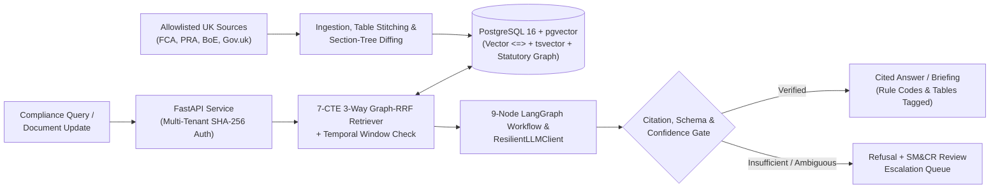

# RegIntel: Architecture, 17 ADRs & 100-Task UK Statutory Graph-RAG Benchmark

[](https://github.com/studioarh/regintel-benchmarks/actions/workflows/ci.yml)


> **Architecture & Benchmark Showcase Repository (Open-Core Split):**
> This public repository provides the **17 Architecture Decision Records (`docs/decisions/`)**, the **100-Task UK Statutory Evaluation Benchmark & Committed Run Artifacts (`data/evaluation/`)**, and **selected core retrieval, statutory graph parsing, layout-aware table reconstruction, hierarchical diffing, and deterministic citation validation modules** from the **RegIntel** platform.
>
> The full commercial multi-tenant SaaS monorepo (React 19 Compliance Workbench, 9-Node LangGraph Orchestrator, Multi-Tenant SHA-256 API Key Auth, and Automated Regulatory Feed Polling) is maintained in a private commercial repository and is live in production below.

---

## 🌐 Live Production Deployment

- **Interactive React 19 Compliance Workbench (Includes 1-Click Zero-Setup Sandbox):** [`https://regintel-web.onrender.com`](https://regintel-web.onrender.com)
- **Production FastAPI Base URL:** [`https://regintel-api-ugia.onrender.com`](https://regintel-api-ugia.onrender.com)
- **Interactive Swagger UI (OpenAPI Docs):** [`https://regintel-api-ugia.onrender.com/docs`](https://regintel-api-ugia.onrender.com/docs)
- **Health Check Endpoint:** [`https://regintel-api-ugia.onrender.com/health`](https://regintel-api-ugia.onrender.com/health)

---

## 1. What Is Included in This Public Repository?

To allow engineering leaders, technical reviewers, and researchers to inspect our core retrieval algorithms, strict static typing (`mypy --strict`), and empirical evaluation benchmarks without exposing proprietary commercial SaaS workflows, this repository contains:

| Module / Directory | Path | What It Demonstrates |
| :--- | :--- | :--- |
| **1. 7-CTE 3-Way Statutory Graph-RRF SQL Engine** | [`apps/api/app/services/retrieval.py`](apps/api/app/services/retrieval.py) | Single-pass PostgreSQL 16 query fusing `pgvector` HNSW cosine distance (`<=>`), `ts_rank_cd` GIN full-text search, and 1-hop `chunk_cross_references` statutory graph traversal (`rrf_k = 60`, `graph_weight = 1.15`). |
| **2. UK Statutory Rule & Relation Parser** | [`src/retrieval/statutory_parser.py`](src/retrieval/statutory_parser.py) | Deterministic regex + $\pm 80$-char verb-window parser across **33 UK FCA Handbook sourcebooks** (`SYSC`, `PRIN`, `DISP`, `ESG`, `CASS`, `MAR`, `SUP`, `CONC`, `MCOB`, etc.) classifying edges into `AMENDS`, `SUPERSEDES`, `EXEMPTS`, and `REFERENCES`. |
| **3. Layout-Aware PDF & HTML Table Stitcher** | [`apps/api/app/services/table_extraction.py`](apps/api/app/services/table_extraction.py) | Extracts HTML `<table>` tags and PyMuPDF `page.find_tables()` grids, stitching column headers across multi-page continuations and formatting self-contained 10-row `[REGULATORY TABLE]` Markdown blocks + `table_metadata` JSONB. |
| **4. Two-Stage Deterministic Citation Gate** | [`apps/api/app/services/validation.py`](apps/api/app/services/validation.py) | Pre-LLM retrieval confidence gating (`validate_retrieval_quality`) and post-LLM verbatim substring verification (`validate_answer_citations`) driving **100.00% Verbatim Citation Correctness** and **0 Unsupported Claims**. |
| **5. Section-Tree Hierarchical Document Differ** | [`apps/api/app/services/diffing.py`](apps/api/app/services/diffing.py) | SHA-256 section-hashed hierarchical differ scaling up to **2,000,000 characters (~800 PDF pages)** with interval-overlap chunk matching (`get_relevant_chunks_for_diff`). |
| **6. Deterministic Temporal Window Verifier** | [`src/retrieval/freshness.py`](src/retrieval/freshness.py) | Parses relative lookback windows (`last/past/previous N days/weeks/months/years`) and computes `is_chunk_within_window: bool` against authoritative PostgreSQL publication dates. |
| **7. 100-Task Evaluation Benchmark & Run Artifacts** | [`data/evaluation/`](data/evaluation/) & [`src/evaluation/`](src/evaluation/) | 100-task stratified UK regulatory benchmark (`benchmark_100-3.jsonl`) and all three raw experimental run artifacts (`baseline_run_final.json`, `optimized_run.json`, `optimized_run_2.json`). |
| **8. 17 Architecture Decision Records (ADRs)** | [`docs/decisions/`](docs/decisions/) | Complete architectural decision log (`ADR-0001` through `ADR-0017`), plus [`docs/architecture.md`](docs/architecture.md), [`docs/evaluation-results.md`](docs/evaluation-results.md), and [`docs/threat-model.md`](docs/threat-model.md). |

---

## 2. Empirical Benchmark Progression (`data/evaluation/benchmark_100-3.jsonl`)

Evaluated across our **100-task labelled UK regulatory benchmark** (`70` positive grounded tasks with ground-truth `expected_chunk_ids` and `30` negative/adversarial refusal tasks requiring `should_escalate = true`):

| Metric (`src/evaluation/metrics.py`) | Stage 1: Vector Baseline (`baseline_run_final.json`) | Stage 2: 2-Way Hybrid RRF (`optimized_run.json`) | Stage 3: 3-Way Statutory Graph-RRF (`optimized_run_2.json`) |
| :--- | :---: | :---: | :---: |
| **Retrieval Recall@5** (`compute_recall_at_k`) | 47.14% (`0.4714`) | 52.14% (`0.5214`, +10.61% rel) | **62.86% (`0.6286`, +33.35% rel vs. Vector / +20.56% vs. 2-Way)** |
| **Verbatim Citation Correctness** (`verify_citation_exact_match`) | 11.83% (`0.1183`) | 13.76% (`0.1376`) | **100.00% (`1.0000`, +88.17% abs)** |
| **Unsupported Claims (Total across 100 tasks)** | 128 claims | 120 claims (-6.25%) | **0 claims (-100.00% — zero hallucinated claims)** |
| **Escalation Recall** (`compute_escalation_metrics`) | **100.00% (`1.0000`)** | **100.00% (`1.0000`)** | **100.00% (`1.0000` — 30/30 unsafe queries refused)** |
| **Escalation Precision** (`compute_escalation_metrics`) | 93.75% (`0.9375`) | 93.75% (`0.9375`) | **68.18% (`0.6818` — strict runtime gate refuses weak citations)** |
| **End-to-End RAG + Judge P50 Latency** | 15.86s | 26.33s | **20.53s (-22.02% P50 vs. 2-Way RRF)** |

---

## 3. System Architecture Overview



---

## 4. Run Quality Gates & Unit Tests Locally

```bash
pip install -e ".[dev]"
ruff check .
ruff format --check .
mypy --strict --explicit-package-bases src/ apps/ config/
pytest tests/
```

---

## License & Copyright

Copyright (c) 2026 Abdulrahman (`studioarh`). All Rights Reserved.
Published as Source-Available for technical architecture review, benchmark verification, and academic/engineering evaluation. Commercial redistribution or unauthorized SaaS hosting is prohibited.
