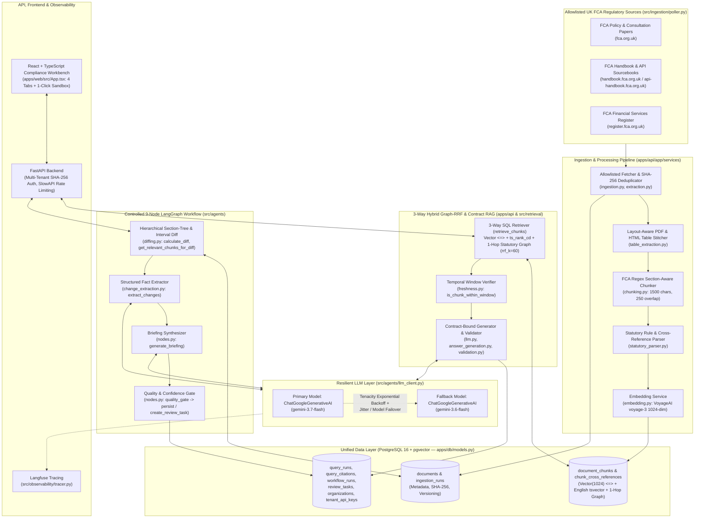
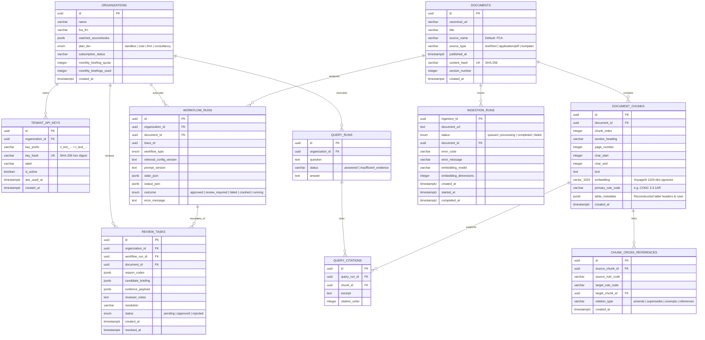

# RegIntel System Architecture

## 1. High-Level System Architecture

**RegIntel** is a traceable regulatory intelligence platform designed for UK consumer-lending compliance teams. It ingests allow-listed FCA publications, indexes them in a unified PostgreSQL 16 + `pgvector` database for **3-Way Graph-Augmented Reciprocal Rank Fusion (RRF)** search, and executes both contract-enforced RAG Q&A and a controlled 9-node **LangGraph** workflow to produce source-cited compliance briefings.

---

## 2. End-to-End Component Flow

### 2.1 Document Ingestion, Table Reconstruction & Statutory Graph Indexing
1. **Allowlisted Fetching (`src/ingestion/poller.py` & `apps/api/app/services/ingestion.py`):** Manual ingestion (`POST /v1/documents/ingest`) and feed polling (`POST /v1/documents/poll-fca`) validate target URLs against `ALLOWED_FCA_HOSTS` (`fca.org.uk`, `handbook.fca.org.uk`, `api-handbook.fca.org.uk`, `register.fca.org.uk`) and execute inside an isolated background SQLAlchemy session (`_run_background_ingestion`).
2. **Idempotency & Version Tracking:** A SHA-256 `content_hash` is computed over normalized document text. Unchanged documents short-circuit idempotently; updated content for an existing `canonical_url` increments `version_number`.
3. **Layout-Aware Table Extraction (`apps/api/app/services/table_extraction.py`):** Extracts HTML `<table>` tags and PDF tables (`page.find_tables()`), stitching column headers across multi-page continuations and formatting self-contained `[REGULATORY TABLE]` Markdown blocks plus structured `DocumentChunk.table_metadata` JSONB.
4. **Chunking, Statutory Graph Edges & Embeddings (`chunking.py`, `statutory_parser.py`, `embedding.py`):** Documents are split into structure-aware chunks (`1500` chars, `250` overlap) using FCA Handbook regex lookaheads (`CONC`, `DISP`, `PRIN`, `MCOB`, `SYSC`), tagged with `primary_rule_code`, linked via 1-hop edges in `chunk_cross_references` (`amends`, `supersedes`, `exempts`, `references`), and embedded via **VoyageAI (`voyage-3`, `Vector(1024)`)**.

### 2.2 3-Way Graph-Augmented RRF Retrieval & Temporal Freshness Enrichment
When a user submits a compliance question via `retrieve_chunks` (`apps/api/app/services/retrieval.py`):
1. **Vector Search CTE (`vector_search`):** Ranks the top `:candidate_limit` (25) chunks using `pgvector` cosine distance (`dc.embedding <=> cast(:embedding as vector)`).
2. **Lexical Search CTE (`text_search`):** Ranks the top `:candidate_limit` (25) chunks using PostgreSQL full-text search (`ts_rank_cd(to_tsvector('english', dc.text), plainto_tsquery('english', :query_text))`).
3. **Statutory Graph CTE (`graph_search`):** Matches chunks whose `primary_rule_code` appears in the query or that are linked via 1-hop `chunk_cross_references` edges from the top vector/lexical seed chunks.
4. **3-Way Reciprocal Rank Fusion (`fused`):** Merges all three ranked lists inside a single SQL query:
   $$RRF\_Score = \frac{1}{60 + rank_{vec}} + \frac{1}{60 + rank_{lex}} + \frac{1.15}{60 + rank_{graph}}$$
5. **Deterministic Temporal Window Check (`is_chunk_within_window` in `src/retrieval/freshness.py`):** Extracts relative time constraints (`last/past/previous N days/weeks/months`) and tags each chunk and `Citation` with `is_within_window: bool`.

### 2.3 Contract-Enforced Generation & Controlled 9-Node LangGraph Workflow
1. **Evidence-Cited Q&A (`generate_answer` & `generate_answer_with_contract`):** Invokes `ResilientLLMClient` with strict Pydantic structured outputs (`AnswerResponse`), validates every citation via `validate_answer_citations` (`apps/api/app/services/validation.py`), and populates `retrieved_chunk_ids`, `retrieved_chunk_excerpts`, `primary_rule_code`, `referenced_rules`, and `table_metadata`.
2. **9-Node LangGraph Regulatory Briefing Pipeline (`src/agents/graph.py` & `src/agents/nodes.py`):**
   - `load_document` $\rightarrow$ `get_prior_version` $\rightarrow$ `create_diff` (hierarchical section-tree diffing + interval-overlap chunk matching in `diffing.py`) $\rightarrow$ `retrieve_evidence` $\rightarrow$ `extract_facts` $\rightarrow$ `generate_briefing` $\rightarrow$ `quality_gate` $\rightarrow$ conditional routing to `persist_approved_briefing` or `create_review_task`.

---

## 3. Database Schema (PostgreSQL 16 + `pgvector` — `apps/db/models.py`)

